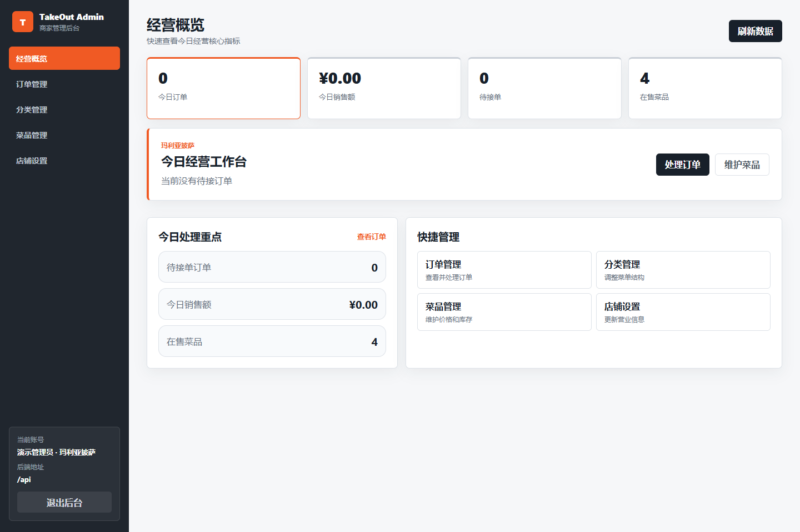
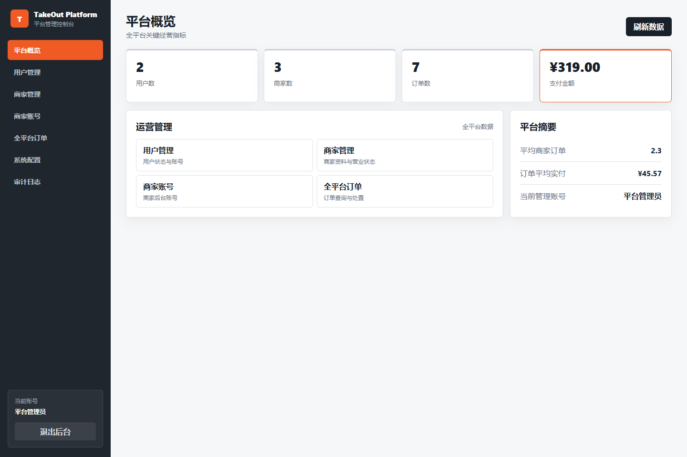
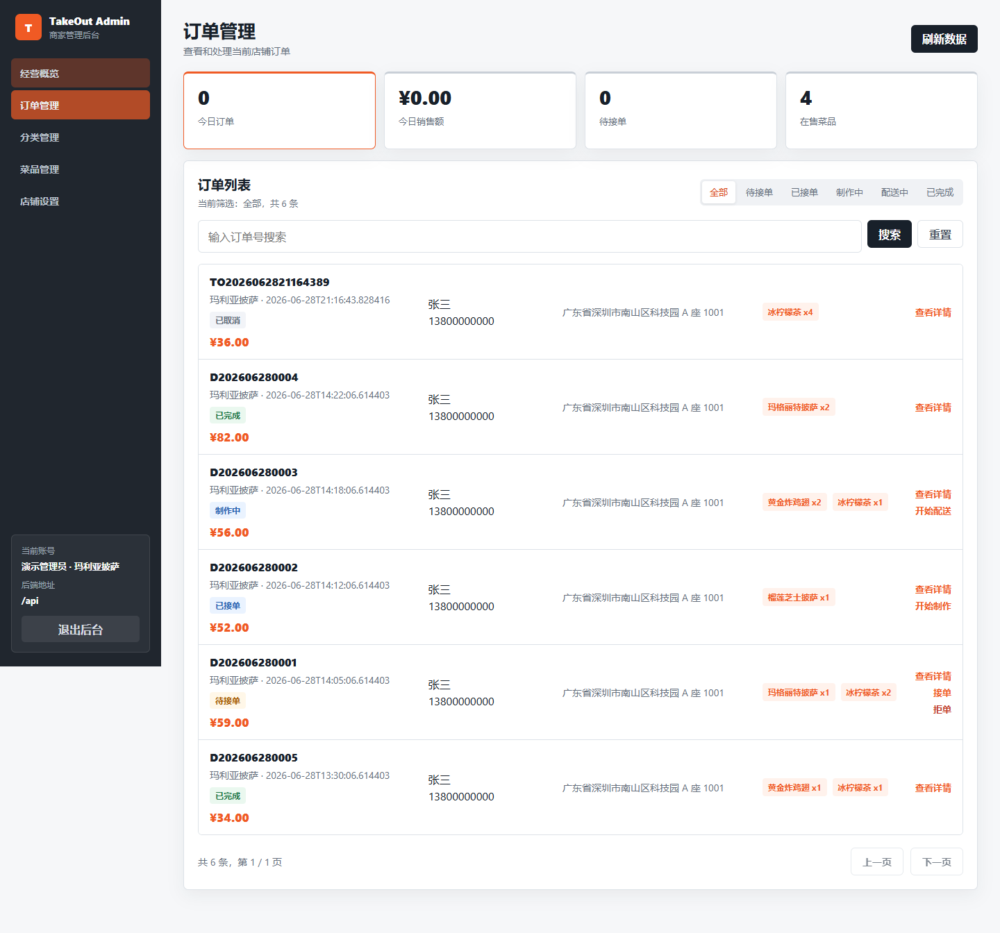
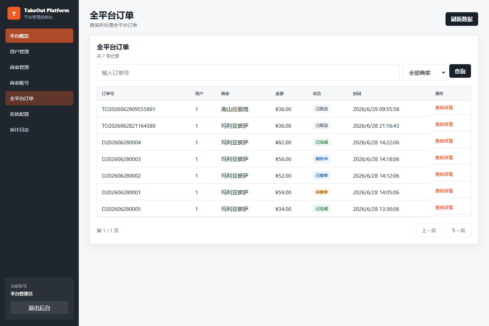

# docs

项目文档目录。

- `requirements.md`：需求说明
- `api.md`：接口文档
- `database.md`：数据库设计
- `deployment.md`：部署说明
- `architecture.md`：系统架构和模块边界
- `order-flow.md`：订单状态和流转规则
- `checklist.md`：运行和发布前检查清单

## 界面预览

| 商户端 | 平台端 |
| --- | --- |
|  |  |
|  |  |

移动端预览：

- [商户端移动布局](screenshots/merchant-mobile.png)
- [平台端移动布局](screenshots/platform-mobile.png)
